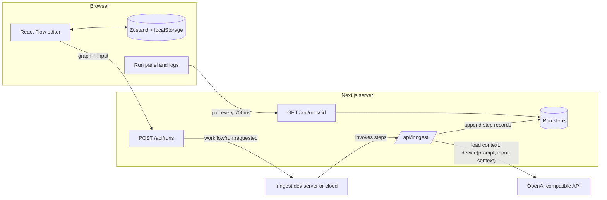
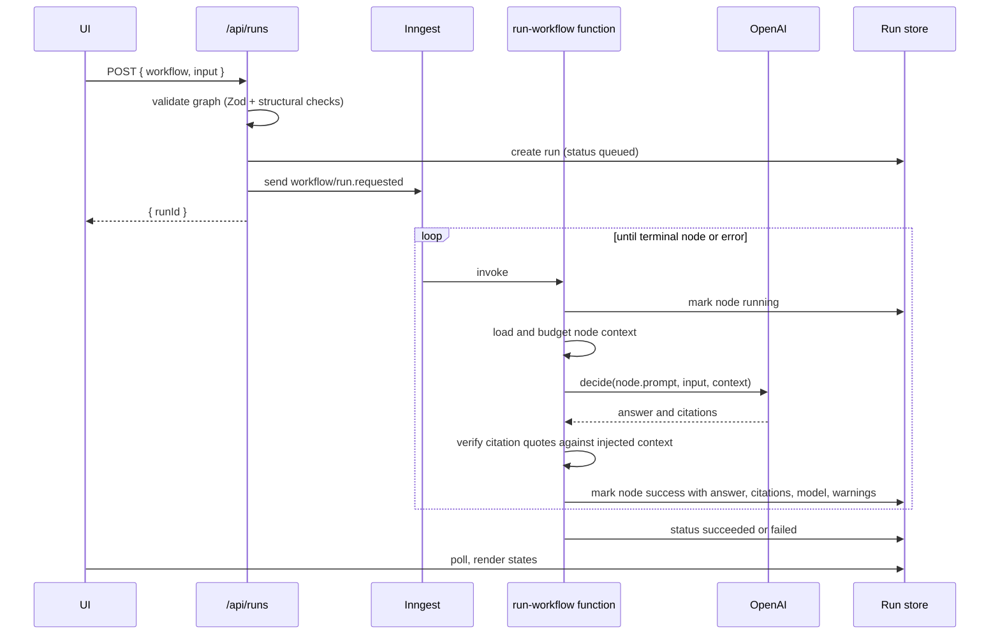

# Architecture

## Goals

- Edit a decision graph visually.
- Execute it durably, one node per Inngest step.
- Every node returns exactly `YES` or `NO`, and the answer selects the next edge.
- Show execution live on the canvas.

## System overview



## Data flow for one run



## Domain model

All types are inferred from Zod schemas in `src/lib/schemas`.

- **Workflow**: `{ id, name, startNodeId, nodes[], edges[] }`
- **DecisionNode**: `{ id, type: "decision", position, data: { label, prompt, context } }`
- **BranchEdge**: `{ id, source, target, sourceHandle: "yes" | "no", type: "yes" | "no" }`
- **Answer**: `"YES" | "NO"`
- **RunState**: `{ runId, status, input, startedAt, finishedAt?, steps[], outcomeNodeId?, error? }`
- **StepRecord**: `{ nodeId, visit, attempt, status, answer?, citations, grounded, warnings, model?, error?, startedAt, durationMs? }`

Each decision node has two source handles, `yes` and `no`, and one target handle. The handle an edge leaves from defines its type, so the edge type can never disagree with the handle.

### Graph invariants (checked before a run starts)

1. `startNodeId` exists in `nodes`.
2. Every edge references existing nodes.
3. A node has at most one outgoing `yes` edge and at most one outgoing `no` edge.
4. Every node has a non-empty prompt.
5. Missing branch edge is legal: the run ends there and that node is the outcome.
6. Cycles are legal but bounded by `WORKFLOW_MAX_STEPS`.

## Execution algorithm

```ts
let current = workflow.startNodeId
const visits = new Map<string, number>()

while (current) {
  assert(totalSteps++ < MAX_STEPS)
  const visit = (visits.get(current) ?? 0) + 1
  visits.set(current, visit)

  const answer = await step.run(`node:${current}:visit:${visit}`, () =>
    decideAndRecord({ runId, node, input, visit })
  )

  const edge = findEdge(workflow, current, answer === "YES" ? "yes" : "no")
  if (!edge) { outcome = current; break }
  current = edge.target
}
```

Why this shape:

- Inngest re-executes the function body on every step boundary and memoizes completed steps. The loop is deterministic given memoized answers, so replays take the same path.
- Anything with a side effect (LLM call, store write) lives inside `step.run`, so it happens once per visit even across replays.
- The `visit` counter keeps step ids unique when a cycle revisits a node.

## The decision call

Located in `src/lib/ai/decide.ts`.

- Model from `OPENAI_MODEL`, `temperature: 0`.
- System prompt from `.agents/prompts/decision-node-system.md` (mirrored as a constant in `src/lib/ai/prompt.ts`).
- User message separates the run input, optional context sources, and node question into delimited blocks.
- Response constrained with a JSON schema for `{ answer, citations }` when supported, then validated with Zod.
- Citation ids and quotes are verified against the exact text injected into the prompt. Unsupported citations cannot ground an answer.
- `LLM_STRUCTURED_OUTPUT=auto` retries one 4xx response without the schema, except 401, 403, and 429. `schema` disables fallback, and `off` omits the response format.

## Error handling and retries

| Failure | Behavior |
| --- | --- |
| OpenAI 429 or 5xx, network error | Step throws, Inngest retries (function `retries: 2`) |
| Output not YES or NO | Throw, retried, then run fails |
| Invalid graph | Rejected by `/api/runs` with 400 and a list of issues, never reaches Inngest |
| Max steps exceeded | `NonRetriableError`, run fails with a cycle message |
| Missing `OPENAI_API_KEY` | Rejected at request time with a clear error |

Each failed attempt writes a `StepRecord` with `status: "error"` before rethrowing, so the logs panel shows retries. The function `onFailure` handler sets the run status to `failed`.

## Run store

`src/lib/run-store.ts` exposes `createRun`, `appendStep`, `updateRun`, `getRun`.

- Dev implementation: a `Map` on `globalThis` (survives Next.js hot reload), optionally mirrored to `.data/runs/<id>.json`.
- Works locally because the Inngest dev server calls back into the same Next.js process.
- **Not durable and not multi-instance safe.** For production, swap for Redis, Postgres, or Inngest Realtime behind the same interface. The interface is the contract, keep it small.

## Frontend visualization

- `useRunPolling(runId)` fetches `/api/runs/:id` every 700 ms until status is terminal.
- Node visual state is derived from the latest `StepRecord` per node: `idle`, `running`, `success-yes`, `success-no`, `error`.
- An edge is animated when its source finished with the matching answer and its target is `running` or not yet visited.
- The logs panel renders `steps[]` in order with answer, duration, and error text.

## Persistence

- Workflow graph: Zustand `persist` to localStorage under key `yesno-flow:workflow:v1`.
- Import validates with the Zod `WorkflowSchema` before replacing state. Export downloads the validated JSON.
- Schema changes bump the key version and add a migration.

## Security

- API keys are server-only. Nothing under `NEXT_PUBLIC_` holds a secret.
- Run input is untrusted data. Context content is trusted as facts and untrusted as instructions. When the two disagree about a fact, context wins. Delimiter look-alikes are neutralized before injection.
- Imported context refs are relative names under `CONTEXT_DIR`. File resolution rejects traversal, reserved Windows names, mismatched extensions, oversized files, NUL bytes, and symlinks outside the root.
- Required context that cannot load fails the node step. Optional failures are recorded as warnings. The model cannot cause arbitrary filesystem reads or SQL execution.
- Context budgets are applied in source order. Defaults are 8,000 characters per source and 12,000 total.
- `/api/runs` validates body size and graph size (limits: 100 nodes, 200 edges, 4 000 chars per prompt, 8 000 chars of input).
- `/api/inngest` is protected by Inngest signing keys in production.

## Tradeoffs

| Decision | Chosen | Alternative | Reason |
| --- | --- | --- | --- |
| Live updates | Polling | SSE or Inngest Realtime | Simplest thing that works in 2 hours, easy to replace |
| Graph sent in event | Full graph snapshot | Graph id lookup | Run is reproducible and no server storage of graphs |
| Output control | Structured output + Zod | Free text parse | Fewer invalid outputs, explicit failure path |
| Store | In-memory | DB | Scope and time, interface allows swap |

## Phase mapping

| Phase | Modules delivered |
| --- | --- |
| 1 | Project scaffold, env, Inngest client, `/api/inngest` with a hello function |
| 2 | Schemas, workflow store, canvas, node editor, YES and NO edges |
| 3 | `decide`, `run-workflow`, `/api/runs`, run store, traversal |
| 4 | Visual execution state, logs panel, JSON import and export, animated edges, error handling and retry display |
| 5 | Per-node file, database, and keyword context; verified citations; context API and editor; model and grounding logs |

## Context retrieval

Each node can refer to up to 10 sources by id, format, and registry or file reference. File formats are Markdown, text, JSON, and YAML. The server loads sources inside the node's Inngest step on every visit and retry. Structured files are flattened into stable key paths. Context remains a bounded block in the user message, never part of the system prompt.

The trust boundary is deliberate: prompts are workflow-author instructions, context is factual data, and run input is untrusted data. Context takes precedence over input for facts. The model returns an answer plus citation claims. The server drops unknown ids, clears unsupported quotes, and marks a decision grounded only when a quote is found in the injected source text. A node can require at least one verified citation.

`CONTEXT_DIR` defaults to `./context`. File size defaults to 256 KiB, the per-source text budget to 8,000 characters, and total context to 12,000 characters. Database query names and vector collection names are listed from server-side registries. The database adapter uses an in-memory fake by default; a production adapter must use a read-only connection. The vector adapter uses deterministic keyword overlap and can be replaced with an embedding store behind `EmbeddingStore`.

## Open questions

- Should a node be allowed to carry a label shown on the canvas separate from its prompt? (Current answer: yes, `data.label` is optional display text.)
- Should an empty branch end the run silently or warn in the editor? (Current answer: allowed, editor shows a subtle dashed handle.)
